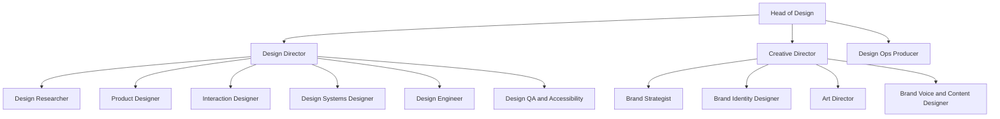
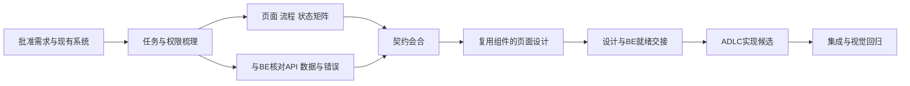

# Agentic Creative Team Pack 需求与架构草案

状态：Brainstorm proposal，尚未成为可注册、可运行的 Pack。日期：2026-10-30。

目标是建立覆盖 Product Design 与 Brand Strategy / Brand Identity 的创意团队能力包，沿用 PolyForge Graph 的版本化角色、工作流、决策和证据机制。三套上游内容作为完整、可追溯的来源进入包，通过统一能力目录与适配层按任务加载。组织关系、设计方向、工具运行和产物验收由本 Pack 明确定义。

本草案最优先的用户路径是：**一个需求 → 少量关键问题 → 3–5 张静态设计概念图 → 一个附概念简介的 HTML 展示页**。选定概念后，另一个工作流再生成完整网页设计图。SaaS 增量设计必须继承已经接受的设计语言，并与 BE 的数据、权限和状态契约衔接。

## 已确认需求和默认假设

| ID | 要求 | 验收含义 |
| --- | --- | --- |
| CR-01 | 整合 designer-skills、taste-skill、impeccable | 每个上游可追溯到固定提交、路径、许可；同一任务不会无条件叠加三套冲突指令 |
| CR-02 | 包含产品设计与品牌策略及识别 | 产品方法与品牌定位、主张、语言、视觉识别都具有明确负责人和产物 |
| CR-03 | 产品团队归 Design Director，品牌团队归 Creative Director，两者归 Head of Design | 组织汇报与具体产物评审分别配置，不用 UI 文案冒充决策权限 |
| CR-04 | 一个需求加少量问题快速产出 design concept | 默认问最多 3 个高价值问题；必要时追加最多 2 个，已知信息不重复问 |
| CR-05 | 3–5 张 static image，封装一个 HTML page，附 concept 简介 | 图片真实生成、可打开；每张有稳定 ID、简介、差异与取舍；页面不是 3–5 个可操作产品原型 |
| CR-06 | 一个选定 concept 加信息生成完整网页设计图 | 输出覆盖页面全部约定 section 的桌面与移动设计图、内容与状态说明；不能只交 hero |
| CR-07 | 配合 BE 开发 SaaS，保持一致设计语言和连贯性 | 页面引用同一版本基线；导航、组件、文案、状态与 API/权限匹配 |
| CR-08 | Interview HTML 记录回复并形成需求 | 保存原始答复与来源，另生成结构化需求；编辑、缺省与推论可区分 |
| CR-09 | 多个 graph 适应不同性质设计任务 | 按任务、已有品牌/系统和风险路由；不要求每次运行全团队 |

CR-05 采用用户最后的更正：静态图加单页展板。此前“每个方案做 HTML 并截图”的选择已被替换。

访谈部署尚未指定，草案采用可更改的默认值：先支持本地保存和 JSON/Markdown 导出，分享链接与多人集中收集作为第二个 adapter。前端技术栈不预先锁死，继承目标项目；Figma 是可选输出能力，不作为所有 graph 的前置条件。快速概念默认 3 个，明确需要更广探索时为 4 或 5 个。速度与成本先记录实测，不能由“quick”标签推导出固定分钟数。

## 研究基线

| 来源 | 固定提交 | 核对结果 | 在新 Pack 中的主要位置 |
| --- | --- | --- | --- |
| designer-skills | `9a6930cf84a822eb458624bd11c61aac5bbdf224` | 本仓库 9 plugins、111 skills、34 commands；主要是设计知识与 Markdown 作业流程 | 研究、产品策略、交互、系统、方案选择、交付知识层 |
| taste-skill | `12af471f627f866411b4bd785b19646d3672784c` | 当前一个主 skill；包含方向库、页面/app 分流、素材与浏览器检查脚本 | 艺术指导、视觉语言探索、网页执行与检查 adapter |
| impeccable | `02523aec3e4c4580102d996d1b6a71fbe062e03f` | 当前 24 commands、引擎和检查规则，包含概念选择、持久设计上下文、图到实现流程 | 概念展示参考、设计上下文、改进命令、审查与还原度控制 |

以上来自固定版本的 [designer-skills README](https://github.com/Owl-Listener/designer-skills/blob/9a6930cf84a822eb458624bd11c61aac5bbdf224/README.md)、[Taste README](https://github.com/Leonxlnx/taste-skill/blob/12af471f627f866411b4bd785b19646d3672784c/README.md)、[Impeccable README](https://github.com/pbakaus/impeccable/blob/02523aec3e4c4580102d996d1b6a71fbe062e03f/README.md)。逐库研究见 [designer-skills](research/designer-skills-2026-10-30.md)、[taste-skill](research/taste-skill-2026-10-30.md)、[impeccable](research/impeccable-2026-10-30.md)。

本地衔接依据为 Core `0.8.4`，提交 `3b8325e66d9d0181e1bfd1e9a398c6b91b4a177a`；ADLC `0.1.10`，提交 `74797995a645b2282d0f32cc3fc11e7c01e558e2`。核对了 [Core contract](../src/core/contract.md)、[Graph engine](../src/core/engine.mjs)、[ADLC README](../../Paperclip-PolyForge-Graph-ADLC/README.md)、[ADLC design graph](../../Paperclip-PolyForge-Graph-ADLC/design-graph.mjs) 和 [角色目录](../../Paperclip-PolyForge-Graph-ADLC/roles/catalog.mjs)。本次没有执行上游安装器或修改现有运行中的 Pack。

### 三者不能原样叠加的地方

1. **探索目标不同。** designer-skills 的 `parallel-concepts` 要求固定视觉语言、比较行为差异；品牌 territory 则固定策略和受众、探索不同视觉语言。Pack 必须明确 `explorationMode`，避免把五种颜色当五个产品方案，或在已有 SaaS 页面上擅自换品牌。[原始 skill](https://github.com/Owl-Listener/designer-skills/blob/9a6930cf84a822eb458624bd11c61aac5bbdf224/prototyping-testing/skills/parallel-concepts/SKILL.md)
2. **候选数量规则不同。** Impeccable 的 new-work 依据判断控制候选数，visualize 的 comp 轮固定为 3。Pack 以用户的 3–5 个要求为上层契约；不足时继续产生有实质差异的候选或明确标记未完成，不能用弱方案凑数。[new-work](https://github.com/pbakaus/impeccable/blob/02523aec3e4c4580102d996d1b6a71fbe062e03f/skill/reference/new-work.md)、[visualize](https://github.com/pbakaus/impeccable/blob/02523aec3e4c4580102d996d1b6a71fbe062e03f/skill/reference/visualize.md)
3. **不能把整套网站构建当快速概念工作。** Taste README 对完整 build 的自述约 30–45 分钟、数十万 tokens；这是上游描述，不是本 Pack 的实测。快速图路线只取方向、内容与视觉判断，暂不运行完整页面实现和浏览器修复循环。[Taste README](https://github.com/Leonxlnx/taste-skill/blob/12af471f627f866411b4bd785b19646d3672784c/README.md)
4. **品牌创建仍有缺口。** designer-skills 的品牌检查依赖已有 mood、voice、tokens；Taste 旧 `brandkit`、`imagegen-*` 已移到其他仓库。不能把这些移走的能力算进本次三个来源，也不能把产品愿景直接当品牌定位。[品牌检查](https://github.com/Owl-Listener/designer-skills/blob/9a6930cf84a822eb458624bd11c61aac5bbdf224/visual-critique/skills/critique-brand-consistency/SKILL.md)、[Moved skills](https://github.com/Leonxlnx/taste-skill/blob/12af471f627f866411b4bd785b19646d3672784c/README.md#moved-skills)
5. **默认审美不能覆盖项目品牌。** Taste 的页面与 app 规则、Impeccable 的反模式检查需要转为有作用域的 profile。既定品牌可以有带理由的例外；颜色、字体或装饰偏好不能与可访问性、内容真实性、数据正确性混成同一级检查。
6. **临时问答不是需求仓库。** Impeccable 的问题页提供选项与 steer，但运行时答案文件有消费和清理行为。需要在 adapter 层先持久化原始回复，再生成需求投影。[详细证据](research/impeccable-2026-10-30.md)

## 组织和角色

以下是建议的组织图。14 个角色表示职责，不要求 14 个同时在线的 Agent。一个实际 Agent 可以承担几个角色，但独立评审要使用不同执行上下文；有利益冲突的决策不能靠换角色名称消除。



Head of Design 的上级沿用宿主公司配置，本草案不替用户指定。Design Ops Producer 是共享支持角色，可在小团队由 Head of Design 承担。

| Role ID | 负责的结果 | 主要能力 | 决策边界 |
| --- | --- | --- | --- |
| `head-of-design` | 跨产品与品牌的一致方向、资源与冲突处置 | brief routing、concept selection、baseline governance | 处理跨域设计取舍；不替代 CPO 产品范围或 CTO 技术批准 |
| `design-director` | 产品设计质量和体验连贯性 | UX strategy、interaction、design evaluation | 接受产品设计规格和兼容现有系统的变更 |
| `creative-director` | 品牌策略到视觉表达的一致性 | brand strategy、art direction、identity review | 接受品牌方案和品牌系统变更 |
| `design-ops-producer` | 需求、排程、产物和决策记录可追溯 | interview collection、artifact registry、handoff | 管理流转与完整性，不代替用户做偏好选择 |
| `design-researcher` | 有来源的用户事实、需求和洞察 | interview-script、synthesis、research repository | 不把推论或模型合成访谈记为用户证据 |
| `product-designer` | 信息架构、任务路径、页面结构和概念 | brief、IA、parallel concepts、wireframes | 提出产品方案，不自行改变已批准产品范围 |
| `interaction-designer` | 状态、反馈、权限体验和恢复路径 | state-machine、forms、onboarding、errors | 与 BE 核对行为可实现性 |
| `design-systems-designer` | tokens、组件、模式与版本变更 | component-spec、governance、theming、extract/document | 提议基线升级，不覆盖所有并行分支正在使用的版本 |
| `design-engineer` | 可检查的布局原型、前端设计实现与截图 | Taste page/app、Impeccable build/adapt/harden | 工程实现遵守项目栈与 API 契约；重大架构交 CTO |
| `design-qa-accessibility` | 独立视觉、行为、一致性和无障碍证据 | audit、critique、fidelity、state coverage | 不能评审自己作为作者提交的候选 |
| `brand-strategist` | 定位、价值主张、受众、差异和可信依据 | 新增 brand-positioning、promise-and-proof | 不编造市场证据、客户评价或未证实的品牌承诺 |
| `brand-identity-designer` | 识别体系及跨触点应用 | 新增 identity system、色彩/字体/图形规范 | Logo、字标和生产规范需要相应矢量与资产检查能力 |
| `art-director` | 有区别的创意 territory、概念图和视觉资产方向 | Taste direction、Impeccable comps、新增 territory exploration | 对概念图统一把控，不让各生成线程自行改 brief |
| `brand-voice-content` | 品牌语言、信息层级、文案和命名建议 | UX writing、content strategy、新增 messaging system | 产品事实归 PRODUCT；语气可变而事实不可改 |

组织 `reportsToRole`、产物 `review.supervisorRole` 和授权 `decisionRules` 是三个不同配置。默认日常决策交领域 Director；Head of Design 只参与跨域、基础方向和重大基线变化。用户对概念的偏好选择不等于全部功能或交付验收。

建议保留 `manual`、`assisted`、`autonomous` 三种运行策略。默认 assisted：常规研究和制作可推进，最终概念选择需要真实用户决定或事先明确的选择授权。用户已授权代理选择时按该范围执行；接口失败、超时或空回复都不产生授权。

## Pack 的组织方式

建议包名 `agentic-creative-team-pack`，Pack ID `creative-team`。新 Pack 与 ADLC 并列，通过版本化交接连接。

```text
agentic-creative-team-pack/
  index.mjs
  roles/catalog.mjs
  roles/<role>/{soul,role,goal,instruction,decision_model}.md
  skills/catalog.mjs
  skills/<adapted-capability>.md
  graphs/*.mjs
  contracts/*.schema.json
  adapters/{designer-skills,taste,impeccable,image-provider,interview,adlc}/
  templates/{concept-gallery,interview,web-design,saas-spec}/
  policies/{authority,context-precedence,review,artifact-lifecycle}.md
  sources/upstream.lock.json
  sources/{designer-skills,taste-skill,impeccable}/
  THIRD_PARTY_NOTICES.md
  eval/fixtures/
```

这是拟议结构，并非本轮已创建的目录。

“整个进去一个 pack”按两个层次落实：保留三仓库完整来源快照或可复现锁定引用；运行时仅加载命中的 canonical skill/reference 和必要 adapter。生成给不同宿主的重复副本不重复注册。每个适配能力记录 upstream repo、SHA、path、license、改动说明、触发条件、排除条件、输入、输出及评审标准。

上层路由只选一个主要执行方法，按需附加专门检查。例如品牌概念以 Art Director 的 concept 方法为主，借 Taste 方向素材与 designer-skills 选择标准；已存在 SaaS 页面以原系统和 app 方法为主，附加 Impeccable audit。不能同时要求 Taste 随机换方向、Impeccable 再选世界、designer-skills 固定视觉语言。

建议上下文优先关系为：用户当前明确约束与范围 → 已批准产品/品牌/系统决策 → 当前 surface brief → 选定 concept → 项目技术与工具能力 → 当前任务的上游方法 → 上游默认审美。内容事实、API 权限与审美偏好分开处理；任何重大冲突产出 change proposal，而不是静默覆盖。

路由再使用独立于 explorationMode 的 `surfaceMode`，借鉴 Impeccable 的四类访问目的。一个品牌可以同时有四类页面，不必把官网表现力原样搬进工作台：

| surfaceMode | 主要目的 | 常见页面 | 设计优先级 |
| --- | --- | --- | --- |
| `persuade` | 理解、相信、采取行动 | 官网、营销、定价 | 信息主张、真实证据、品牌表达、主要行动 |
| `operate` | 稳定完成任务 | SaaS、后台、编辑器 | 数据、状态、熟悉控件、效率和一致性 |
| `read` | 阅读和理解 | 文档、帮助、内容页 | 排版、结构、检索与可读性 |
| `experience` | 探索和感受作品 | 展示、作品集、互动体验 | 叙事、探索方式、视觉与动效节奏 |

上游将 Operate/Read 的实现偏向 code-led。Pack 的静态概念预览仍服从 CR-05，明确只是结构/视觉假设；进入实际 SaaS 制作时，再使用代码与真实状态验证，不能以一张图替代操作体验。[上游新建路由](https://github.com/pbakaus/impeccable/blob/02523aec3e4c4580102d996d1b6a71fbe062e03f/skill/reference/new-work.md)

许可证登记：designer-skills 和 Taste 声明 MIT，Impeccable 声明 Apache-2.0。复制与适配时保留各自许可、版权和适用通知，并记录修改；素材和字体的来源条件单独记录，不能把代码许可当作所有示例素材的使用许可。整个新 Pack 的发布许可在选定分发方式后再确认，不由本草案默认继承。[Designer license](https://github.com/Owl-Listener/designer-skills/blob/9a6930cf84a822eb458624bd11c61aac5bbdf224/LICENSE)、[Taste license](https://github.com/Leonxlnx/taste-skill/blob/12af471f627f866411b4bd785b19646d3672784c/LICENSE)、[Impeccable license](https://github.com/pbakaus/impeccable/blob/02523aec3e4c4580102d996d1b6a71fbe062e03f/LICENSE)

## 共享上下文和设计语言

统一基线至少分为四层，避免只统一颜色而行为和文案继续漂移：

| 层 | 权威内容 | 负责角色 |
| --- | --- | --- |
| Product truth | 用户、任务、产品事实、批准范围、成功标准、明确未知项 | Product Designer 与外部 CPO/PO |
| Brand foundation | 定位、承诺、证据、人格、语气、识别规则、资产 | Creative Director |
| Design system | 语义 tokens、字体、间距、组件、图标、密度、主题、响应式 | Design Systems Designer / Design Director |
| Experience contracts | 导航、任务顺序、权限、异步状态、反馈、错误恢复、文案术语 | Interaction Designer / Design Director |

权威文件建议采用 PRODUCT.md、BRAND.md、DESIGN.md、tokens.json、components.json、patterns.md、content-voice.md、assets.manifest.json。`design_baseline` 索引它们的精确版本和 digest；每个页面另外有 surface brief 和 state matrix。API 契约单独引用，不写进品牌文档。

兼容层把这些权威材料投影成上游期望的文件，例如 designer-skills 的 mood.md/voice.md/tokens.md、Impeccable 的上下文与 design.json，以及 Taste 的方向配置。投影注明来源版本，不能成为第二份可自由修改的事实源。

并行工作在自己的工作区和工具状态目录中运行。上游脚本的工作目录、缓存、问题回复和历史都需隔离；仅改输出文件名不足以保证隔离。所有基线更新先成为 proposal，再由负责角色接受新版本；执行中的其他页面继续引用旧版或显式 rebase，不能被自动改写。

## 工作流目录

| Graph | 适用情境 | 主要结果 | 负责方 |
| --- | --- | --- | --- |
| G01 `creative-intake` | 模糊需求、访谈、已有资料整理 | 版本化 brief、需求、证据和路由 | Design Ops + Researcher |
| G02 `brand-foundation` | 从零品牌、再定位、品牌识别更新 | 品牌策略与识别基线 | Creative Director |
| G03 `concept-sprint` | 快速看 3–5 个 design concept | 静态图集合、简介、单 HTML gallery | Art Director，按任务联合 Product Designer |
| G04 `concept-to-web-design` | 已选概念，展开完整网页 | 全页设计图、移动版、状态/内容规格 | Design Director |
| G05 `saas-feature-design` | 与 BE 合作设计 SaaS 功能 | 统一页面/流程规格、API/状态契约、工程交接包 | Design Director + 外部 BE owner |
| G06 `design-system-evolution` | 系统首次建立、补组件、升级或治理 | 可复用设计系统及迁移说明 | Design Systems Designer |
| G07 `design-assurance` | 审查现有页面、实现还原度或回归 | 当前候选的发现、修复和验证记录 | 独立 Design QA |
| G08 `brand-campaign-assets` | 营销活动、社媒、演示和跨触点资产 | 服从品牌基线的多规格资产包 | Creative Director |

G01 可路由到其他 graph，但不默认串行执行全部。G04 或 G05 的设计交付完成后，可通过 cross-pack handoff 进入 ADLC implementation / verification。G07 可用于设计阶段和实现后，但两类报告必须标明评审对象与证据范围。

### G01 creative-intake

输入：一段需求、现有素材、项目上下文、访谈方式和用户已回答的问题。

路径：读取已有资料 → 识别能改变方案的未知项 → 生成最多 3 个首轮问题 → 对话或 interview HTML 收集 → 固化原始答复 → 提炼需求与约束 → 展示可纠正的 brief → 分类路由。

原始答复与需求分开存。每个 REQ-ID 引用回答/文件段落；事实、偏好、约束、假设、未决问题分别标记。访谈可表达“暂不知道”，不强迫用户选择捏造答案。若追加追问，总计默认不超过 5 个，更多研究需进入明确的深访路线。

终态：`brief_ready`、`needs_information` 或 `no_design_work`。快速预览可以带标记假设进入 G03；改变产品行为或影响 BE 契约的未知项，不能在 G05 中悄悄补全。

Interview HTML 的能力：有语义的标签和输入、条件问题、自动保存提示、恢复填写、显式提交、导入/导出 JSON、生成 Markdown brief。默认使用本地持久化和可下载文件；浏览器清理、跨设备和多人收集需要独立存储能力，不能声称静态 HTML 已实现服务器保存。

托管模式另接 authenticated submission adapter：project/session/questionnaireVersion/responseRevision 绑定，服务端接收确认与幂等键；提交保存和 Graph 回调分开，回调失败也不会丢失答复。问题 ID、题目版本、原始文本、提交时间和来源留存。只有经宿主确认的真实答复能进入 decision authority；普通偏好提交不自动批准预算、scope 或发布。

### G02 brand-foundation

输入：产品事实、目标受众、竞争/客户证据、已有品牌资产、必须保留的识别要素与变更范围。

路径：受众与市场证据 → 定位与差异 → 品牌承诺及支持证据 → 语言与创意策略 → territory exploration → 识别体系 → 跨触点验证 → 品牌基线接受。

新增能力应覆盖 audience/category frame、positioning、promise/proof、personality、messaging、naming brief、identity system、brand governance。不是只添加一个 logo skill。命名或标志提案的概念接受与正式生产资产检查分别记录。

territory exploration 可复用 G03 的产物格式；品牌策略是该轮固定条件，视觉语言允许不同。选择后补全字标/图形、颜色、字体、插画/摄影、语气、版式和 do/don't。输出品牌指南、资产清单、token 起点与落地例子。Logo 的最终生产文件使用可编辑矢量和相应检查；概念阶段的位图不能自动视为正式 logo 资产。

终态：`brand_baseline_ready`、`strategy_needs_evidence` 或 `brand_direction_pending`。已有品牌且只加产品页面时跳过这条完整流程。

### G03 concept-sprint

这是最优先实现的 graph。输入：brief、3–5 的目标数量、surface 类型、explorationMode、可选品牌/系统基线、参考图和真实内容。


具体节点建议：`read-context` → `clarify-brief` → `plan-concept-set` → `choose-count` → `render-c1..c5` → `freeze-set` → `review-set` → `assemble-gallery` → `gallery-ready`。

Core 当前是静态 DAG；实现时生成固定五个分支，count=3 激活前三个，count=4 激活前四个，count=5 激活全部。ALL join 只等待激活分支。也可以由一个任务调用 provider 批量产生图片，但必须保留每个候选自己的身份、状态和成本记录，不能虚构动态 foreach 节点。最小版采用批量任务，后续再细化独立分支。

explorationMode 的固定条件：

| 模式 | 固定什么 | 可以变化什么 |
| --- | --- | --- |
| `brand-territory` | 受众、定位、承诺、真实内容、交付尺寸 | 情绪、视觉语言、字体方向、图像处理、版式体系 |
| `product-structure` | 品牌/系统、目标任务、内容、数据、视口 | 信息架构、操作顺序、主导区域、交互模型的视觉表达 |
| `surface-composition` | 已选 concept、品牌、主要功能和文案 | 内容层级、布局、密度、视觉焦点与构图 |

默认 3 个明确不同的概念。4–5 个用于真实不确定性更高的任务。先按预设比较条件写概念说明，再生成图；不要把同一图的换色或不同完成度算成多个概念。每个候选至少要能说清“它在测试哪个不同的设计假设”。

图片要求：相同目标尺寸/视口、相近完成度、同一内容基线、主体和主要行动清楚。使用已有品牌时传入真实参考图及基线，不只靠文字重述。逐张打开检查；缺图、无法解码、关键主体缺失或概念重复必须修复或标记 incomplete。概念图中的微小文字不作为准确文案或无障碍验收证据。

Gallery 交付结构：

```text
concept-sprint/<run-id>/
  index.html
  concepts.json
  images/concept-01.png ... concept-05.png
  sources/brief.json
  feedback.json              用户有反馈后才生成
```

每张卡片含名称、一句核心理念、约 80–120 字简介、3 个关键设计选择、适用情境及一个诚实取舍。HTML 可放大、并列比较、做选择或备注；只有这一层交互，不冒充每个设计已可操作。默认使用相对图片路径打包成一个展示页和资产目录；若需要单文件离线传阅，可另做图片内嵌导出。

本 graph 的成功终点是 `concept_gallery_ready`，无需等待用户选中才能交付预览。选择作为独立事件保存：`select`、`revise`、`combine`、`none`。combine 必须产出新的候选图与版本，再明确选择；不能把未展示的拼合结果记成已批准概念。继续 G04/G05 必须有 selected concept 或明确委托选择的记录。工具失败或没有反馈不产生默认接受。

选择记录同时保留未选方案的理由和重新考虑条件。这样后续需求变化时可以有依据地复用旧探索，而不是把已经讨论过的方向当作新发现。

快速流程默认每候选一次初始生成和一次有理由的修复机会；额度用完返回已生成内容与缺口，不无限循环。实际延迟取决于图像 provider，先记录 first-preview latency、set latency、生成次数和费用，再确定预算目标。若没有图像生成能力，返回 capability gap；用户要求静态概念图时不能静默换成文字或产品 HTML。

### G04 concept-to-web-design

输入：选定概念的精确图片与版本、brief、页面目标、完整内容、必须包含的 section、品牌/系统约束和视口范围。仅选一张图不等于所有未写明的功能已获批准。

路径：解读 concept 的不可变特征 → 内容和 section map → 全页结构 → 桌面设计展开 → 移动布局和重点状态 → 独立 fidelity/内容检查 → 全页设计图包。

选定概念生成 direction contract，写明必须继承的色彩角色、字体气质、构图逻辑、图像语言、组件性格，以及只用于概念表达而不能直接照搬的细节。默认交付一张完整桌面页和一张移动页；长页可同时提供全长图与 section 裁图，不能只有首屏。页面数量由 brief 决定，多页网站必须有 route/page inventory。

生成方式依任务选择图像扩展、可编辑设计源或内部 HTML 布局渲染。内部 HTML 只用来准确排版和截图时，其身份是 design source，交付仍是设计图；只有另行选择实现路径时才成为可运行产品。图中的文字由 copy 文件保存准确版本，交互通过 state/flow 规格补充。

终态 `web_design_package_ready`。输出 whole-page images、mobile images、section map、copy、assets、state notes、fidelity report 和 pinned design identity。审查发现重构了已选概念的主体或构图时回到对应制作节点；改 concept 则新开选择记录，不偷偷重新艺术指导。

### G05 saas-feature-design

输入：已批准的功能需求、产品决策、现有页面与代码、design_baseline、组件库、API 或 BE 契约提案、角色权限和数据样例。没有系统时先进入 G06 的 bootstrap 路线；没有确定 API 时可以并行提出契约，但不得把 mock 当作已连接。



需要与 BE 联合明确：schema、nullability、枚举、分页/排序/过滤、时区与本地化、validation、权限/RBAC、tenant 隔离表现、错误格式、异步任务、部分成功、重试/幂等、实时更新、乐观更新与回滚。每个页面 state 指向触发它的条件和 API/权限来源；缺失契约就保留 unknown 与 owner，不让设计师编造一个已存在的 endpoint。

共用状态覆盖：loading、empty、success、validation error、server error、permission denied、stale/offline、partial success；仅纳入与功能相关的状态，注明不适用理由。SaaS 连贯性还包括全局导航、筛选和搜索、表格密度、表单布局、键盘行为、通知、确认/撤销、保存反馈和术语。

BE 约束改变既定体验时记录 contract delta。兼容调整由 Design Director 处置；改变产品行为交 CPO/PO；改变技术架构交 CTO/BE owner；跨品牌/体验取舍再交 Head of Design。Graph 不改变用户指定的组织汇报关系。

首个关键页面先验证 shell、组件和真实数据契约，作为后续页面的代表性基线。其他页面在独立工作区中并行；禁止每页再运行品牌方向抽签或重选字体。组件缺口走 G06 的局部提案，获接受后再消费新版本。

设计阶段终态 `saas_design_ready`。工程阶段通过 ADLC 独立推进，回传固定实现候选与实际 API 测试证据后进入 G07；只有 mock 验证时标记 `design_validated`，不能声明 `integration_verified`。

### G06 design-system-evolution

输入：既有系统与差异清单，或新品牌/产品方向。路径：inventory → raw/semantic/component tokens → component & pattern contracts → 代表页验证 → accessibility → 版本影响分析 → Director 接受。

输出新的 design_baseline、组件规范、主题/密度/响应式映射、迁移记录和受影响页面清单。一次局部缺口不应重建全部系统。基线以版本引用消费，不使用“最后写入者获胜”；并发变更声明 expectedBaseline，合并冲突由系统负责人处理。

### G07 design-assurance

输入：固定的设计或代码候选、所依据的 concept/系统版本、检查范围与可执行环境。路径：冻结候选 → 视觉/品牌检查与 UX/状态/无障碍检查 → 归并发现 → 有界修复 → 在相同范围重验 → review disposition。

检测分为三类：可执行的事实检查、专家判断、审美偏好。源代码扫描不能证明渲染对比度；静态概念图不能证明键盘可达性。使用 Impeccable/Taste 检查时记录 target、版本、实际命令/浏览器观察和排除规则。已批准品牌的字体等偏好可形成局部例外，但不能把真正功能失败变为 pass。

评审者与作者使用独立执行身份。默认最多两轮集中修复；无进展或超预算时带未决问题交责任人，不自动重开全部探索。只验证若干修复项的报告不能扩大表述为整个产品通过。终态 `design_verified`、`revision_required` 或 `verification_incomplete`。

### G08 brand-campaign-assets

输入：brand_baseline、campaign brief、受众和触点清单。路径：信息主张与证据 → creative concept → 关键视觉 → 渠道尺寸与语言适配 → 品牌检查 → 资产包。

输出可用资产、各渠道尺寸/裁切规则、文案版本、alt text、来源与许可记录。网站、产品内推广、社媒、演示或邮件保持同一品牌人格，但允许不同内容节奏和布局。正式发布仍由相应宿主或业务流程执行。

## 产物契约

下面是拟议的 Pack 级数据模型，不是 Core 目前已经认识的新 outputContract 类型。

| Artifact kind | 必需内容 |
| --- | --- |
| `creative_brief` | project、目标、受众、surfaceMode、explorationMode、范围、约束、内容引用、assumptions、openQuestions、REQ-ID 与来源 |
| `interview_responses` | questionnaire ID/version、response revision、问题 ID、原始回答、来源、时间、附件引用 |
| `concept_set` | briefRef、explorationMode、requestedCount、固定比较条件、concept refs、生成/评审状态 |
| `concept_candidate` | ID/version、thesis、区别、简介、图片 ref/digest/尺寸、prompt/provider、sourceRefs、baselineRef、取舍 |
| `concept_selection` | setRef、选中候选精确版本、用户或获授权决策者、选择理由、保留和禁止改变项 |
| `brand_baseline` | positioning、promise/proof、audience、voice、visual rules、assets、批准记录 |
| `design_baseline` | brand/product refs、tokens/components/patterns/content refs、版本、digest、批准记录、迁移信息 |
| `web_design_package` | selectedConceptRef、page/section inventory、copy、desktop/mobile images、states、assets、reviewRef |
| `saas_design_spec` | REQ/AC refs、baselineRef、route/state/permission matrix、API contract ref、未知项与 owner |
| `design_review` | exact subjectRefs、scope、observations、pass/fail/unverified、finding IDs、修复/例外及证据 |

可以采用统一 envelope：`id, kind, version, projectId, runId, nodeId, attemptId, authorExecutionId, sourceRefs, subjectRefs, digest, status`。字段表示产物的可追溯身份，不让模型自报身份替代宿主认证。原始答复不可被整理后的需求覆盖，图片被替换后必须产生新版本；下游选择和评审引用旧版本时保持历史但不能批准新内容。

Gallery 的选择可先记录为 preference；只有获得角色权限、明确选择范围且引用当前候选的 Decision Record 才是流程批准。HTML 页面本身不能因按钮被点击就拥有修改 Pack 或产品决策的权限。

## 与 ADLC 和 Core 的集成

复用 ADLC 的五份 role 文档、skill discovery metadata、decision rules、版本化 Pack、`decisionTraceRequired`、独立评审与 `subjectRefs`。Core 的 `reportsToRole` 组织描述和 `review.supervisorRole` 评审配置继续分离。[ADLC index](../../Paperclip-PolyForge-Graph-ADLC/index.mjs)

现有 ADLC `final-design` 节点虽然写着 `decisionTitle: 'Head of Design'`，实际 `role` 仍是 `cpo`。新 Pack 不能只改这个标题就声称已经实现新组织。应新建真实 `head-of-design` 授权模型；CPO 保留产品范围和最终产品验收，CTO 保留技术及工程接受。

推荐 cross-pack 路径：ADLC accepted requirement → Creative G01/G03/G04 或 G05 → `creative_design_handoff` → ADLC implementation → 固定实现候选 → Creative G07 与 ADLC verification。hand-off 包含 requirement、product decision、concept、design baseline、设计规格、API 契约、验收准则和授权身份的精确引用。

当前 Core 已支持 cross-pack plans/handoff，但必须在源与目标 Pack 声明匹配关系，并满足项目、终态、产物版本与 digest 校验。现有 ADLC 不会因为出现一个同名 JSON 字段就自动信任 Creative 的接受记录；需要发布明确的 ADLC bridge 更新和兼容测试。进行中的老 run 继续使用旧快照，不原地迁移角色或证据。[Core contract](../src/core/contract.md)

运行机制约束：

- Graph 使用 `task / decision / join(all) / end`。等待访谈回复由待完成任务与宿主回调表达，不发明 `wait` 节点；重做使用有界 `reworkTarget`，不添加环边。
- 新增 artifact kind 可以放在 `produces` 中，但它只保证存在版本化产物；当前 Core 的 typed input/output contracts 是固定集合。新 schemas 需要 Pack validator 由可信 host 调用，或另行设计 Core 的扩展注册机制；仅写 schema 文件不算运行时强制校验。[evidence contracts](../src/core/evidence-contracts.mjs)
- Image generation、图像读取、HTML 文件写入、浏览器、可选 Figma/托管访谈、API 检查等必须由宿主声明真实能力。缺少能力只影响相关 graph，不把品牌研究也一并禁用。
- Taste/Impeccable 不直接运行各自安装器、全局 hooks、隐式更新或用户目录写入。adapter 将脚本和引擎绑定到已审核版本，隔离状态，声明所需网络和执行能力。原始工具规则作为来源材料适配，不作为可越过宿主权限的指令。
- 完整源代码入包与启用所有运行工具是两回事。发布包的 provenance/许可证可完整保留，实际执行工具由各 graph preflight 决定。

## 建议的实现顺序和验收

第一阶段先打通 G01 → G03：角色骨架、来源注册、访谈记录、image-provider adapter、3–5 图的检查、单 HTML 展板和可持久化反馈。通过三个 brief 类型验证：新品牌落地页、已有品牌产品页、已有 SaaS 功能。交付成功的标准是图片与简介可审阅、数目与差异满足请求、源资料和选择可追溯。

第二阶段实现 G02/G04/G06：补品牌主干，建立统一基线，验证选中概念可以可靠展开为完整桌面/移动页面。第三阶段实现 G05/G07 与 ADLC bridge：接真实项目栈、BE 契约、实现候选和独立检查。G08 在品牌基线稳定后加入。

重点评估用例：

1. count=3/4/5 的分支与 ALL join 正确；缺图或重复图不能被标为完整。
2. 已有品牌时，各概念保留规定的识别要素；brand-territory 允许视觉分化而产品事实不变。
3. 选中的旧图被替换后，旧选择不能批准新图；combine 产生新版本与新选择。
4. Interview 刷新、导出、重新导入、修改答复和版本升级不丢原始内容；无存储能力时明确显示未保存。
5. 同一套 SaaS 的 list/detail/settings 三页保持 tokens、导航、组件、术语和状态一致；系统升级有明确影响清单。
6. API 或权限变化被 state matrix 捕捉；mock pass 不等于集成 pass。
7. 作者不能批准自己的独立评审；外部选择按钮不能伪造 human-owner 身份。
8. 缺图像工具、缺浏览器或回复接口失效时给出真实 blocked/incomplete 状态，不自行换交付形式或推定用户同意。
9. Pack/Graph 版本升级不改变已有 run；上游更新必须重跑本地验收样例。

评估指标分开记录：有效概念数、首次有用预览耗时、用户选择/重做轮数、基线一致性缺陷、选图到完整页面的结构还原度、状态覆盖、真实集成检查结果与成本。模型自评分可以帮助排队，不能作为人类喜欢或商业效果已被证明的证据。

## 后续讨论的选择

以下是可调整方案，不阻塞当前架构草案：

- Pack 与 ADLC 并列独立发布，还是在同一分发套件中提供两个 Pack；推荐独立版本、共同 catalog。
- 概念选择默认由用户完成，或在明确规则下交 Head of Design；推荐 assisted 默认，允许任务级委托。
- Interview 是否需要第一版就支持外部客户、多用户和登录；推荐先本地可恢复与导出，保存契约从第一版就稳定。
- 完整网页设计图是否还要 Figma 可编辑源、生产前端或两者；推荐把它们声明为不同终态，避免设计图交付被误认为完整产品。
- 品牌资产是否包含正式 logo/命名/多语言手册；推荐保留能力槽位，生产级交付按需要接专门工具和检查。

以上默认值都不授权安装、发布或改变当前公司的真实组织。当前交付是可讨论、可拆成实施任务的需求与工作流设计。
